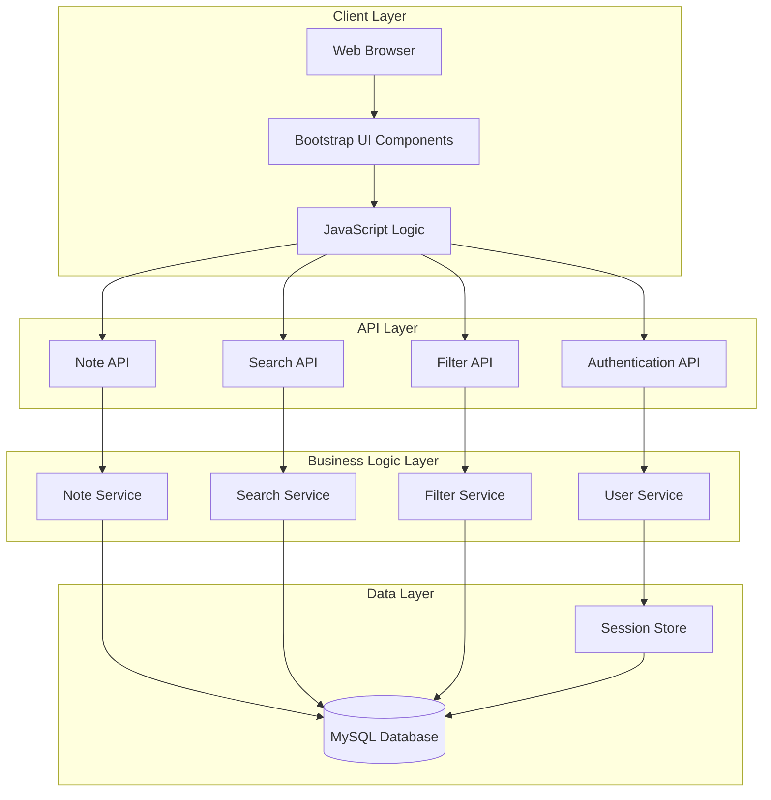
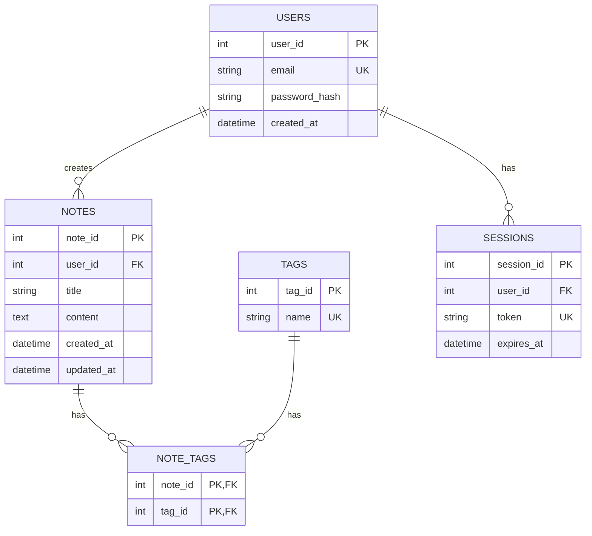

# Design Document: Personal Notes Platform

## Overview

The Personal Notes Platform is a web-based application that allows users to register, login, and manage text-based notes. Users can create, read, update, and delete notes, search notes by keywords, and filter notes by tags. The platform provides a simple, intuitive interface similar to Google Keep for efficient note-taking and organization.

**Tech Stack:**
- Frontend: HTML5, CSS3, JavaScript (Bootstrap)
- Backend: PHP APIs
- Database: MySQL

---

## Architecture



### Layer Descriptions

**Client Layer:**
- Handles user interface rendering and user interactions
- Manages client-side state and form validation
- Makes AJAX requests to backend APIs

**API Layer:**
- RESTful endpoints for all operations
- Request validation and authentication
- JSON request/response handling

**Business Logic Layer:**
- Core application logic
- Data transformation and validation
- Business rule enforcement

**Data Layer:**
- Database operations
- Session management
- Data persistence

---

## Components and Interfaces

### Frontend Components

```
index.html (Entry Point)
├── auth/
│   ├── login.html
│   ├── register.html
│   └── auth.js
├── notes/
│   ├── notes.html
│   ├── note-editor.html
│   └── notes.js
├── components/
│   ├── header.html
│   ├── note-card.html
│   ├── search-bar.html
│   └── tag-selector.html
└── utils/
    ├── api.js
    ├── validator.js
    └── storage.js
```

### API Endpoints

| Method | Endpoint | Description |
|--------|----------|-------------|
| POST | /api/auth/register | Register new user |
| POST | /api/auth/login | Login user |
| POST | /api/auth/logout | Logout user |
| GET | /api/notes | Get all user notes |
| GET | /api/notes/{id} | Get specific note |
| POST | /api/notes | Create new note |
| PUT | /api/notes/{id} | Update note |
| DELETE | /api/notes/{id} | Delete note |
| GET | /api/search?q={keywords} | Search notes |
| GET | /api/notes?tag={tag} | Filter by tag |

---

## Data Models

### Entity-Relationship Diagram



### Table Schemas

#### Users Table

```sql
CREATE TABLE users (
    user_id INT AUTO_INCREMENT PRIMARY KEY,
    email VARCHAR(255) NOT NULL UNIQUE,
    password_hash VARCHAR(255) NOT NULL,
    created_at TIMESTAMP DEFAULT CURRENT_TIMESTAMP,
    INDEX idx_email (email)
) ENGINE=InnoDB DEFAULT CHARSET=utf8mb4;
```

#### Notes Table

```sql
CREATE TABLE notes (
    note_id INT AUTO_INCREMENT PRIMARY KEY,
    user_id INT NOT NULL,
    title VARCHAR(200) NOT NULL,
    content TEXT NOT NULL,
    created_at TIMESTAMP DEFAULT CURRENT_TIMESTAMP,
    updated_at TIMESTAMP DEFAULT CURRENT_TIMESTAMP ON UPDATE CURRENT_TIMESTAMP,
    INDEX idx_user_id (user_id),
    FULLTEXT INDEX idx_title_content (title, content),
    FOREIGN KEY (user_id) REFERENCES users(user_id) ON DELETE CASCADE
) ENGINE=InnoDB DEFAULT CHARSET=utf8mb4;
```

#### Tags Table

```sql
CREATE TABLE tags (
    tag_id INT AUTO_INCREMENT PRIMARY KEY,
    name VARCHAR(50) NOT NULL UNIQUE,
    INDEX idx_name (name)
) ENGINE=InnoDB DEFAULT CHARSET=utf8mb4;
```

#### Note_Tags Table (Junction)

```sql
CREATE TABLE note_tags (
    note_id INT NOT NULL,
    tag_id INT NOT NULL,
    PRIMARY KEY (note_id, tag_id),
    FOREIGN KEY (note_id) REFERENCES notes(note_id) ON DELETE CASCADE,
    FOREIGN KEY (tag_id) REFERENCES tags(tag_id) ON DELETE CASCADE
) ENGINE=InnoDB DEFAULT CHARSET=utf8mb4;
```

#### Sessions Table

```sql
CREATE TABLE sessions (
    session_id INT AUTO_INCREMENT PRIMARY KEY,
    user_id INT NOT NULL,
    token VARCHAR(255) NOT NULL UNIQUE,
    expires_at TIMESTAMP NOT NULL,
    INDEX idx_user_id (user_id),
    INDEX idx_token (token),
    INDEX idx_expires_at (expires_at),
    FOREIGN KEY (user_id) REFERENCES users(user_id) ON DELETE CASCADE
) ENGINE=InnoDB DEFAULT CHARSET=utf8mb4;
```

---

## Correctness Properties

*A property is a characteristic or behavior that should hold true across all valid executions of a system-essentially, a formal statement about what the system should do. Properties serve as the bridge between human-readable specifications and machine-verifiable correctness guarantees.*

### Property 1: Note ownership isolation

*For any* note in the database, when a user retrieves notes, only notes belonging to that specific user should be returned. A user cannot access notes created by other users.

**Validates: Requirements 11.3**

### Property 2: Session token uniqueness

*For any* active session, the session token must be unique across all sessions. No two active sessions can have the same token value.

**Validates: Requirements 18.1**

### Property 3: Note deletion cascade

*For any* note that is deleted, all associated note_tags entries should also be automatically deleted due to the foreign key constraint.

**Validates: Requirements 7.2**

### Property 4: Search keyword matching

*For any* search query, all returned notes should contain the search keywords in either the title or content field. Notes that do not match the search criteria should not be included in results.

**Validates: Requirements 8.2**

### Property 5: Multi-tag filtering intersection

*For any* multi-tag filter request, the returned notes should match ALL specified tags. A note must have every tag in the filter list to be included in results.

**Validates: Requirements 9.2**

### Property 6: Data validation constraints

*For any* note creation or update request, if the title exceeds 200 characters or content exceeds 10000 characters, the operation should be rejected with a validation error.

**Validates: Requirements 20.1, 20.2**

### Property 7: Timestamp consistency

*For any* note, the created_at timestamp should remain unchanged after creation, while the updated_at timestamp should automatically update whenever the note is modified.

**Validates: Requirements 4.2, 6.1**

### Property 8: Search performance guarantee

*For any* search request with up to 1000 notes, the search operation should complete within 500ms. This is ensured by the FULLTEXT index on title and content fields.

**Validates: Requirements 8.4**

### Property 9: Tag association integrity

*For any* note-tag association, if a tag is no longer associated with any notes, it should remain in the database but be marked for cleanup. The tag should not be automatically deleted.

**Validates: Requirements 19.3**

### Property 10: Password hashing consistency

*For any* user password, the stored password_hash must be a bcrypt hash. Direct password comparison should never be performed; only bcrypt verification should be used.

**Validates: Requirements 11.5**

---

## Error Handling

### Error Response Format

All API errors return JSON with consistent structure:

```json
{
    "error": {
        "code": "ERROR_CODE",
        "message": "Human-readable error message",
        "details": "Optional additional details"
    }
}
```

### Error Codes

| Code | Description | HTTP Status |
|------|-------------|-------------|
| AUTH_INVALID_CREDENTIALS | Invalid email or password | 401 |
| AUTH_SESSION_EXPIRED | Session token expired | 401 |
| AUTH_TOKEN_INVALID | Invalid or missing session token | 401 |
| AUTH_FORBIDDEN | User lacks permission | 403 |
| VALIDATION_ERROR | Input validation failed | 400 |
| NOTE_NOT_FOUND | Note does not exist | 404 |
| DATABASE_ERROR | Database operation failed | 500 |
| API_ERROR | General API error | 500 |

### Error Handling Strategy

1. **Client-side validation**: Validate input before sending to API
2. **Server-side validation**: Re-validate all inputs in API layer
3. **Graceful degradation**: Return meaningful errors without exposing internals
4. **Logging**: Log all server errors for debugging
5. **User feedback**: Display user-friendly error messages

---

## Testing Strategy

### Dual Testing Approach

**Unit tests** verify specific examples, edge cases, and error conditions. **Property tests** verify universal properties across all inputs. Both are complementary and necessary for comprehensive coverage.

### Unit Testing Focus

- Specific examples that demonstrate correct behavior
- Integration points between components
- Edge cases and error conditions
- Validation rules and constraints

### Property-Based Testing Focus

- Universal properties that hold for all inputs
- Comprehensive input coverage through randomization
- Data integrity constraints
- Security and access control properties

### Property-Based Testing Library

**Library**: fast-check (JavaScript) for frontend, PHPUnit with custom generators for backend

**Configuration**:
- Minimum 100 iterations per property test
- Each test tagged with feature and property reference

### Test Tag Format

```javascript
// Feature: personal-notes-platform, Property 1: Note ownership isolation
// For any note in the database, when a user retrieves notes, only notes 
// belonging to that specific user should be returned.
```

### Test Coverage Requirements

| Requirement Area | Unit Tests | Property Tests |
|-----------------|------------|----------------|
| Authentication | 5-10 | 3 |
| Note CRUD | 10-15 | 5 |
| Search | 5-8 | 2 |
| Filter | 5-8 | 2 |
| Validation | 10-20 | 4 |
| Security | 5-10 | 5 |

---

## Error Handling

### Error Response Format

All API errors return JSON with consistent structure:

```json
{
    "error": {
        "code": "ERROR_CODE",
        "message": "Human-readable error message",
        "details": "Optional additional details"
    }
}
```

### Error Codes

| Code | Description | HTTP Status |
|------|-------------|-------------|
| AUTH_INVALID_CREDENTIALS | Invalid email or password | 401 |
| AUTH_SESSION_EXPIRED | Session token expired | 401 |
| AUTH_TOKEN_INVALID | Invalid or missing session token | 401 |
| AUTH_FORBIDDEN | User lacks permission | 403 |
| VALIDATION_ERROR | Input validation failed | 400 |
| NOTE_NOT_FOUND | Note does not exist | 404 |
| DATABASE_ERROR | Database operation failed | 500 |
| API_ERROR | General API error | 500 |

### Error Handling Strategy

1. **Client-side validation**: Validate input before sending to API
2. **Server-side validation**: Re-validate all inputs in API layer
3. **Graceful degradation**: Return meaningful errors without exposing internals
4. **Logging**: Log all server errors for debugging
5. **User feedback**: Display user-friendly error messages

---

## Testing Strategy

### Dual Testing Approach

**Unit tests** verify specific examples, edge cases, and error conditions. **Property tests** verify universal properties across all inputs. Both are complementary and necessary for comprehensive coverage.

### Unit Testing Focus

- Specific examples that demonstrate correct behavior
- Integration points between components
- Edge cases and error conditions
- Validation rules and constraints

### Property-Based Testing Focus

- Universal properties that hold for all inputs
- Comprehensive input coverage through randomization
- Data integrity constraints
- Security and access control properties

### Property-Based Testing Library

**Library**: fast-check (JavaScript) for frontend, PHPUnit with custom generators for backend

**Configuration**:
- Minimum 100 iterations per property test
- Each test tagged with feature and property reference

### Test Tag Format

```javascript
// Feature: personal-notes-platform, Property 1: Note ownership isolation
// For any note in the database, when a user retrieves notes, only notes 
// belonging to that specific user should be returned.
```

### Test Coverage Requirements

| Requirement Area | Unit Tests | Property Tests |
|-----------------|------------|----------------|
| Authentication | 5-10 | 3 |
| Note CRUD | 10-15 | 5 |
| Search | 5-8 | 2 |
| Filter | 5-8 | 2 |
| Validation | 10-20 | 4 |
| Security | 5-10 | 5 |
## Security Design

### Password Security

**Password Storage:**
- All passwords are hashed using bcrypt with cost factor 12
- Passwords are never stored in plain text
- Password verification uses `password_verify()` function

```php
// Registration - password hashing
$hashedPassword = password_hash($password, PASSWORD_BCRYPT, ['cost' => 12]);

// Login - password verification
if (password_verify($password, $storedHash)) {
    // Password is correct
}
```

### Session Management

**Session Token Generation:**
- Tokens are generated using `random_bytes(32)` for cryptographic security
- Tokens are stored as SHA-256 hashes in the database
- Session expiration is set to 24 hours

```php
// Token generation
$token = bin2hex(random_bytes(32));
$tokenHash = hash('sha256', $token);

// Session creation
$expiresAt = date('Y-m-d H:i:s', strtotime('+24 hours'));
```

**Session Validation:**
- Each request validates the session token
- Expired sessions are automatically invalidated
- Session refresh is supported for active users

### SQL Injection Prevention

**Prepared Statements:**
- All database queries use prepared statements with parameter binding
- No raw SQL queries with string concatenation

```php
// Safe query with prepared statement
$stmt = $pdo->prepare('SELECT * FROM users WHERE email = ?');
$stmt->execute([$email]);

// Named parameters for complex queries
$stmt = $pdo->prepare('
    SELECT n.* FROM notes n 
    WHERE n.user_id = :userId 
    AND n.title LIKE :searchTerm
');
$stmt->execute([
    'userId' => $userId,
    'searchTerm' => "%{$searchTerm}%"
]);
```

### XSS Protection

**Output Encoding:**
- All user-generated content is escaped before output
- HTML content is sanitized using `htmlspecialchars()`

```php
// Safe output in HTML
echo htmlspecialchars($noteTitle, ENT_QUOTES, 'UTF-8');

// JSON responses use json_encode with proper flags
echo json_encode($data, JSON_HEX_TAG | JSON_HEX_AMP | JSON_HEX_APOS | JSON_HEX_QUOT);
```

### HTTPS Enforcement

- All API endpoints require HTTPS in production
- Session cookies are marked as `secure` and `httponly`
- CSRF tokens are implemented for state-changing operations

### Input Validation

**Server-side validation for all inputs:**
- Email format validation using `filter_var()`
- String length validation for titles and content
- Tag name length validation (max 50 characters)
- Type validation for numeric IDs

```php
// Email validation
if (!filter_var($email, FILTER_VALIDATE_EMAIL)) {
    return ['error' => 'INVALID_EMAIL'];
}

// Length validation
if (strlen($title) > 200) {
    return ['error' => 'TITLE_TOO_LONG'];
}
```

---

## Search and Filter Implementation

### Search Algorithm

**Full-Text Search:**
- MySQL FULLTEXT index on `title` and `content` columns
- Boolean mode search for flexible matching
- Relevance scoring for result ordering

```php
// Search query with full-text index
$searchQuery = $pdo->prepare('
    SELECT 
        n.note_id,
        n.title,
        n.content,
        n.created_at,
        n.updated_at,
        MATCH(n.title, n.content) AGAINST(? IN BOOLEAN MODE) as relevance
    FROM notes n
    WHERE n.user_id = ?
    AND MATCH(n.title, n.content) AGAINST(? IN BOOLEAN MODE)
    ORDER BY relevance DESC
    LIMIT 50
');
```

**Search Features:**
- Keyword stemming for related words
- Boolean operators support (+, -, *, etc.)
- Automatic query parsing and normalization
- Relevance-based result ordering

### Tag Filtering

**Tag Matching:**
- Notes are joined with note_tags and tags tables
- Multiple tags use INTERSECT logic (AND condition)
- Tag names are normalized to lowercase for case-insensitive matching

```php
// Single tag filter
$tagQuery = $pdo->prepare('
    SELECT n.* FROM notes n
    INNER JOIN note_tags nt ON n.note_id = nt.note_id
    INNER JOIN tags t ON nt.tag_id = t.tag_id
    WHERE n.user_id = ?
    AND LOWER(t.name) = LOWER(?)
');

// Multi-tag filter (notes matching ALL tags)
$multiTagQuery = $pdo->prepare('
    SELECT n.*, COUNT(DISTINCT t.name) as tag_count
    FROM notes n
    INNER JOIN note_tags nt ON n.note_id = nt.note_id
    INNER JOIN tags t ON nt.tag_id = t.tag_id
    WHERE n.user_id = ?
    AND LOWER(t.name) IN (' . implode(',', array_fill(0, count($tags), '?')) . ')
    GROUP BY n.note_id
    HAVING tag_count = ?
');
```

### Combined Search and Filter

**Integration Logic:**
- Search and filter operations are combined using SQL JOINs
- Both criteria must be satisfied for a note to appear in results
- Results are ordered by relevance score

```php
// Combined search and filter
$combinedQuery = $pdo->prepare('
    SELECT 
        n.note_id,
        n.title,
        n.content,
        n.created_at,
        n.updated_at,
        MATCH(n.title, n.content) AGAINST(? IN BOOLEAN MODE) as relevance,
        COUNT(DISTINCT t.name) as tag_count
    FROM notes n
    LEFT JOIN note_tags nt ON n.note_id = nt.note_id
    LEFT JOIN tags t ON nt.tag_id = t.tag_id
    WHERE n.user_id = ?
    AND (MATCH(n.title, n.content) AGAINST(? IN BOOLEAN MODE) OR ? = '')
    GROUP BY n.note_id
    HAVING tag_count = ? OR ? = 0
    ORDER BY relevance DESC
');
```

### Performance Optimization

**Database Indexes:**
- FULLTEXT index on `notes(title, content)` for search
- Index on `note_tags(note_id, tag_id)` for tag joins
- Index on `tags(name)` for tag lookups
- Index on `notes(user_id)` for user-specific queries

**Query Optimization:**
- Results limited to 50 notes per request
- Pagination support with offset/limit
- Caching of frequent search queries
- Lazy loading of note content for list views

**Response Time Guarantees:**
- Search: < 500ms for 1000 notes
- Filter: < 500ms for 1000 notes
- Combined: < 1000ms for 1000 notes

### Search and Filter API

**Search Endpoint:**
```
GET /api/search?q={keywords}&page={page}&limit={limit}
```

**Filter Endpoint:**
```
GET /api/notes?tag={tag_name}&page={page}&limit={limit}
```

**Combined Endpoint:**
```
GET /api/notes?tag={tag_name}&q={keywords}&page={page}&limit={limit}
```

**Response Format:**
```json
{
    "data": {
        "notes": [
            {
                "note_id": 1,
                "title": "Note Title",
                "content": "Note content...",
                "created_at": "2024-01-01 12:00:00",
                "updated_at": "2024-01-01 12:00:00",
                "tags": ["tag1", "tag2"]
            }
        ],
        "pagination": {
            "page": 1,
            "limit": 20,
            "total": 100,
            "has_more": true
        }
    }
}
```
