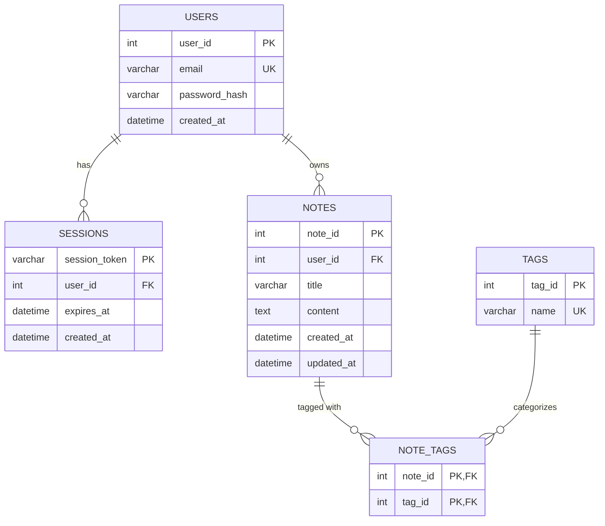

# Codebase Analysis Report: Personal Notes Platform (MicroBlogApp)

**Date:** 2026-10-20  
**Repository:** `MicroBlogApp`  
**Application Name:** Personal Notes Platform  

---

## 1. Executive Summary

The **MicroBlogApp** codebase is a full-stack, modular web application designed as a **Personal Notes Platform**. It allows users to register, log in, create, edit, view, delete, search, and tag notes with persistent storage in MySQL.

The architecture cleanly decouples backend REST APIs (PHP 8+ with PDO) from a single-page frontend (HTML5, Bootstrap 5.3, Vanilla JS). The implementation adheres to strict separation of concerns, defensive security practices (parameterized queries, bcrypt hashing, session token authentication, XSS escaping), and includes comprehensive spec documentation and database migrations under `.kiro/specs/personal-notes-platform`.

---

## 2. Architecture & Tech Stack

### 2.1 Technology Stack

| Layer | Technology / Library | Purpose |
|---|---|---|
| **Frontend UI** | HTML5, Bootstrap 5.3.3 (CDN), Custom CSS (`assets/css/app.css`) | Responsive UI, modal editor, auth forms, notes grid |
| **Frontend Logic** | Vanilla JavaScript (ES6+), Fetch API (`assets/js/api.js`, `app.js`) | SPA state management, asynchronous REST API calls, debounced search |
| **Backend Runtime** | PHP 8.x (`declare(strict_types=1);`) | API endpoints, session handling, business logic |
| **Database** | MySQL / MariaDB via PHP PDO | Relational persistence, connection pooling pattern, transactions |
| **Specifications & Tests** | Kiro specs, PHPUnit (`.kiro/specs/personal-notes-platform/`), standalone CLI test (`test_note_api.php`) | Requirements, design specifications, task breakdown, automated tests |

---

## 3. Directory Structure

```
MicroBlogApp/
├── .kiro/                                  # Project specifications & design docs
│   └── specs/personal-notes-platform/
│       ├── design.md                       # Architectural design doc & API specs
│       ├── requirements.md                 # Detailed functional & non-functional requirements
│       ├── tasks.md                        # Implementation task status tracking
│       ├── phpunit.xml                     # PHPUnit configuration
│       ├── migrations/                     # SQL migration scripts
│       │   ├── 001_create_users_table.sql
│       │   ├── 002_create_notes_table.sql
│       │   ├── 003_create_tags_table.sql
│       │   ├── 004_create_note_tags_table.sql
│       │   └── 005_create_sessions_table.sql
│       └── tests/                          # Automated test suites
├── api/                                    # Backend REST API endpoints
│   ├── auth/                               # Authentication endpoints & middleware
│   │   ├── login.php                       # User login & session creation
│   │   ├── logout.php                      # Session invalidation & logout
│   │   ├── middleware.php                  # Bearer token validation & route guards
│   │   ├── register.php                    # User registration & password validation
│   │   └── session.php                     # Session verification endpoint
│   ├── Database.php                        # PDO connection pooling, session & schema helpers
│   ├── NoteService.php                     # Note & Tag CRUD, search, pagination business logic
│   ├── notes.php                           # REST endpoint: GET, POST, PUT, DELETE /api/notes
│   ├── search.php                          # Full-text search endpoint: GET /api/search?q=...
│   └── tags.php                            # Tag management & filtering: GET /api/tags
├── assets/
│   ├── css/
│   │   └── app.css                         # Custom styling (card limits, typography, responsive tweaks)
│   └── js/
│       ├── api.js                          # Fetch wrapper for HTTP requests with Bearer auth headers
│       └── app.js                          # UI controllers, modal managers, state handlers
├── index.html                              # Single-page application entry point
├── mysql_bkp.sql                           # Legacy/sample database dump
├── test_note_api.php                       # Integration test runner script for NoteService API
└── README.md                               # Project readme overview
```

---

## 4. Database Schema & Data Model

The database (`personal_notes`) consists of 5 normalized relational tables:



1. **`users`**: Stores unique credentials (`email`, `password_hash` via `PASSWORD_BCRYPT`).
2. **`sessions`**: Cryptographically secure 64-char hex tokens (`bin2hex(random_bytes(32))`) with expiry timestamps.
3. **`notes`**: Belongs to a user, includes indexed `user_id` and timestamps, cascading delete on user removal.
4. **`tags`**: Unique normalized tag names (stored in lowercase, alphanumeric and hyphens).
5. **`note_tags`**: Many-to-many junction table linking `notes` and `tags` with composite PK and foreign keys.

---

## 5. Key Modules & Implementation Details

### 5.1 Backend Services & Endpoints

- **`Database.php`**:
  - Implements a static connection pool caching active PDO handles per configuration key.
  - Configures strict PDO modes (`ATTR_ERRMODE => ERRMODE_EXCEPTION`, disabled emulation of prepared statements, `utf8mb4`).
  - Provides core auth and session helper functions (`createSession`, `validateSession`, `destroySession`).
- **`NoteService.php`**:
  - Encapsulates business logic for notes and tag associations inside ACID transactions (`beginTransaction`, `commit`, `rollBack`).
  - Enforces field constraints (title max 255 chars, content length validations).
  - Handles tag resolution (creates tags if not present, links via junction table).
  - Implements pagination (`limit`, `offset`) and search logic across note titles and content.
- **`api/auth/`**:
  - Token-based stateless authentication flow (`Bearer <token>`).
  - Enforces email validation (`filter_var`) and password strength (min 8 chars, lowercase, uppercase, digit).
- **`api/notes.php`, `search.php`, `tags.php`**:
  - Follow REST conventions, validating HTTP verbs (GET, POST, PUT, DELETE), JSON payload parsing, and standard error envelopes.

### 5.2 Frontend Single Page Architecture

- **`index.html`**:
  - Dual-mode container: toggles between `#auth-section` (login/register) and `#app-section` (notes workspace).
  - Uses Bootstrap 5 modal for note authoring/editing with live character counters.
- **`assets/js/api.js`**:
  - Centralized network client managing in-memory tokens.
  - Automatically attaches `Authorization: Bearer <token>` to outbound requests.
- **`assets/js/app.js`**:
  - Manages session lifecycle (`sessionStorage`), error toasts/alerts, note grid rendering, tag filtering, and debounced search (350ms delay).

---

## 6. Security & Best Practices Assessment

### Strengths
- **SQL Injection Prevention:** 100% prepared statements with parameterized inputs throughout `NoteService` and `Database`. Emulated prepares are explicitly turned off (`PDO::ATTR_EMULATE_PREPARES => false`).
- **Password Security:** Hashes passwords with PHP `password_hash($password, PASSWORD_BCRYPT)` and verifies with `password_verify()`.
- **Token Generation:** Uses `random_bytes(32)` to generate unguessable 256-bit session tokens.
- **Strict Typing:** `declare(strict_types=1);` is used across all PHP scripts.
- **XSS Mitigation:** Frontend safely sets text contents via `textContent` rather than `innerHTML` when handling user input. Output JSON uses `JSON_HEX_TAG | JSON_HEX_AMP | JSON_HEX_APOS | JSON_HEX_QUOT`.

### Areas for Improvement / Recommendations
1. **Hardcoded Database Credentials:** Default database credentials (`root` / `Telza#45Max`) are hardcoded in `api/Database.php`. 
   - *Recommendation:* Migrate connection credentials to environment variables or a `.env` file (e.g. `getenv('DB_PASSWORD')`).
2. **CORS / Content Security Policy:** No explicit CORS headers or CSP headers are set if served across domains.
3. **Database Schema Setup Script:** While `.kiro/specs/.../migrations/` has individual SQL migration scripts, an automated migration runner or unified setup CLI tool would make deployment seamless.
4. **Automated Testing:** `test_note_api.php` provides manual smoke testing; running PHPUnit tests under `.kiro/specs/personal-notes-platform/tests/` via CI/CD would safeguard regression testing.

---

## 7. Conclusion

The `MicroBlogApp` is a clean, well-structured, and secure PHP/JS notes application. Its separation between API contracts and front-end UI logic, accompanied by high-quality specification documents in `.kiro/specs/`, provides an excellent foundation for future feature enhancements (e.g., Markdown preview, collaborative notes, image attachments, or dark mode).
